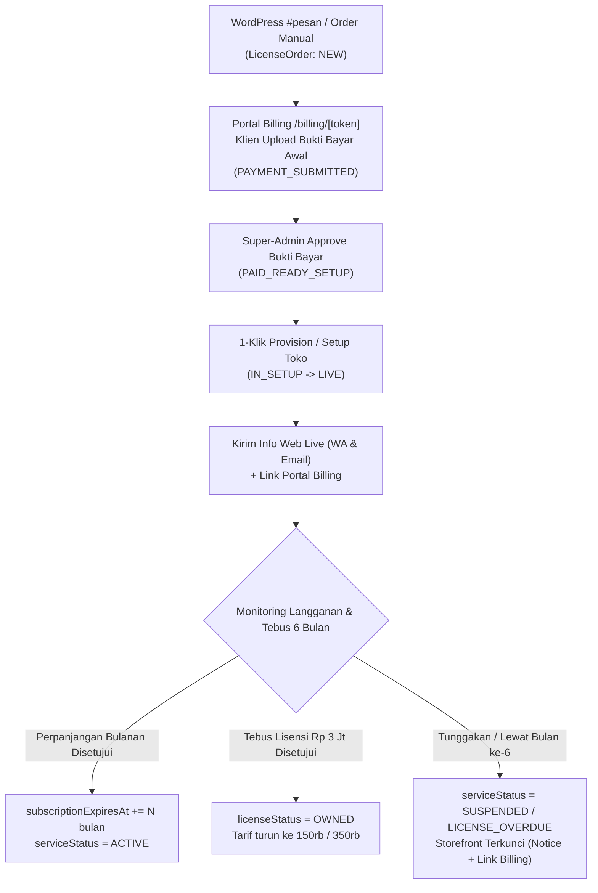

# Blueprint Bisnis & Arsitektur Teknis: Skema Harga 2×2, Order Lisensi, & Manajemen Langganan LarisDari.web.id

Dokumen ini menjadi acuan tunggal untuk skema penetapan harga, ruang lingkup onboarding Custom Domain, *unit economics*, serta arsitektur end-to-end pemesanan lisensi, manajemen langganan bulanan, approval bukti bayar, penebusan lisensi 6 bulan, dan penonaktifan layanan.

---

## 1. Matriks Harga & Aturan Kepemilikan Final

Semua paket sudah mencakup **100% fitur web commerce yang sama**, wajib memakai **Custom Domain milik klien**, dan mendapat **Gratis Support Setting** oleh tim LarisDari.web.id hingga website live.

| Skema Kepemilikan | Shared Infrastructure (`SHARED`) | Dedicated Infrastructure (`DEDICATED`) | Setting Custom Domain & Integrasi |
| :--- | :--- | :--- | :--- |
| **1. Beli Lisensi di Awal (`OWNED`)** Lisensi 1 Website: **Rp 3.000.000** *(1× di awal)* | **Rp 150.000 / bulan** • Total bayar awal: **Rp 3.150.000** *(Lisensi + Bln 1)* | **Rp 350.000 / bulan** • Total bayar awal: **Rp 3.350.000** *(Lisensi + Bln 1)* | **GRATIS (Sudah Termasuk)** |
| **2. Tanpa Lisensi Awal (`DEFERRED_6M`)** Wajib tebus lisensi **Rp 3.000.000** maks. **bulan ke-6** | **Rp 200.000 / bulan** • Bayar awal: **Rp 200.000** • Otomatis turun ke **Rp 150.000 / bln** setelah tebus | **Rp 450.000 / bulan** • Bayar awal: **Rp 450.000** • Otomatis turun ke **Rp 350.000 / bln** setelah tebus | **GRATIS (Sudah Termasuk)** *Lewat bulan ke-6 belum tebus → **Layanan OFF*** |

### Ketentuan Wajib (`DEFERRED_6M` — Maksimal Bulan ke-6)
1. Tanggal batas penebusan (`licenseRedemptionDeadlineAt`) dihitung **+6 bulan kalender** sejak tanggal website pertama kali aktif (`LIVE`).
2. Pengingat dikirim kepada klien secara bertahap sebelum jatuh tempo (H-30, H-14, H-7).
3. Apabila klien mengunggah bukti penebusan **Rp 3.000.000** di Portal Billing dan disetujui (`APPROVE`) oleh Super-Admin:
   - `Store.licenseStatus` berubah menjadi `OWNED`.
   - `Store.licenseRedeemedAt` tercatat pada waktu approval.
   - `Store.monthlyFeeAmount` **otomatis turun** ke tarif normal (`Rp 150.000` untuk `SHARED`, `Rp 350.000` untuk `DEDICATED`).
   - Jika layanan sempat `LICENSE_OVERDUE` / `SUSPENDED`, layanan otomatis kembali `ACTIVE`.
4. Apabila melewati bulan ke-6 lisensi belum ditebus, layanan berubah menjadi **`LICENSE_OVERDUE` (OFF)** dan storefront menampilkan pemberitahuan penonaktifan beserta tombol langsung ke Portal Billing (`/billing/[token]`).

---

## 2. Unit Economics & Mitigasi Arus Kas Awal

### Estimasi HPP Riil per Klien
- **HPP Setup Assisted (Done-For-You):** ~1 – 1,5 jam kerja aktif (provisioning toko, konek DNS Custom Domain + SSL HTTPS, Email SMTP, Biteship, Midtrans/Flip + webhook, Telegram/WA, Pixel, 1× tes checkout) ≈ **Rp 125.000 – Rp 175.000** (`SHARED`) atau **Rp 150.000 – Rp 200.000** (`DEDICATED`).
- **HPP Operasional Server Bulanan:**
  - `SHARED`: **~Rp 85.000 – Rp 115.000 / bulan** → Margin bulanan **+Rp 35rb–65rb** (`OWNED Rp 150rb`) atau **+Rp 85rb–115rb** (`DEFERRED_6M Rp 200rb`).
  - `DEDICATED`: **~Rp 260.000 – Rp 325.000 / bulan** → Margin bulanan **+Rp 25rb–90rb** (`OWNED Rp 350rb`) atau **+Rp 125rb–190rb** (`DEFERRED_6M Rp 450rb`).

### SOP Mitigasi Risiko Bulan ke-1 (`DEFERRED_6M` Gratis Setting)
Karena HPP Bulan ke-1 (setup + server bulan 1) berkisar **Rp 210rb–290rb** (`SHARED`) dan **Rp 410rb–525rb** (`DEDICATED`), maka:
1. Gunakan **SOP Checklist DNS & Integrasi Siap Pakai** di Super-Admin agar waktu setting turun dari 90 menit → **≤ 45 menit**.
2. Gunakan tombol **1-Klik Setup & Provision** langsung dari `LicenseOrder` (otomatis mengisi nama, domain, paket, kategori kas, artikel awal, & token billing).
3. Pantau metrik retensi & status pembayaran bulan 1–2 di tab **Approval Pembayaran** dan **Website & Langganan**.

---

## 3. Batasan Scope "Gratis Support Setting oleh Kita"

- **Termasuk (Done-For-You Onboarding):**
  - Provisioning instance toko terisolasi & akun Admin utama klien.
  - Setup & verifikasi Custom Domain (DNS `A`/`CNAME`, Nginx/Cloudflare, SSL HTTPS).
  - Konfigurasi Email SMTP brand, API cek ongkir Biteship, Midtrans/Flip + webhook, notifikasi Telegram/WhatsApp, serta Meta/TikTok Pixel / GA4.
  - 1× tes transaksi end-to-end sebelum serah terima Go-Live.
- **Tanggung Jawab Klien:**
  - Pembelian dan perpanjangan kepemilikan domain serta akun email custom atas nama bisnis klien sendiri.
  - Pengisian katalog produk & operasional penjualan harian menggunakan panduan `/admin` & fitur impor.

---

## 4. State Machine & Arsitektur Sistem

### Peta Komponen Teknis
1. **Database (`prisma/schema.prisma`, Expand-Only):**
   - `Store`: `infraTier`, `licenseStatus`, `licensePriceAmount`, `licenseRedeemedAt`, `licenseRedemptionDeadlineAt`, `monthlyFeeAmount`, `serviceStatus`, `subscriptionExpiresAt`, `suspendedAt`, `suspendedReason`, `billingPortalToken`.
   - `LicenseOrder`: menyimpan seluruh order masuk dari WordPress/manual beserta status setup (`NEW` .. `LIVE`), `portalToken`, dan relasi ke `Store`.
   - `SubscriptionPayment`: menyimpan bukti transfer `INITIAL_ORDER`, `MONTHLY_RENEWAL`, dan `LICENSE_REDEMPTION` beserta status review (`PENDING_REVIEW` / `APPROVED` / `REJECTED`).
2. **WordPress Landing Page (`wordpress/themes/larisdari-web-landing`):**
   - Seksi `#harga` menampilkan matriks 2×2 interaktif dengan pilihan tombol CTA yang mengisi otomatis `#pesan`.
   - Seksi `#pesan` menyimpan lead lokal ke `lm_lead` dan menembak webhook terautentikasi (`LICENSE_WEBHOOK_SECRET`) ke `/api/webhook/license-order`.
3. **Next.js Control Plane (`/super-admin`):**
   - Tab `Pesanan Lisensi`: kelola status order, 1-klik provision, salin pesan Go-Live WA, dan prefill duplikasi.
   - Tab `Approval Pembayaran`: preview gambar/PDF bukti transfer & approve/reject dengan efek otomatis ke masa aktif / tebus lisensi.
   - Tab `Website & Langganan`: kelola masa aktif, ganti tier, dan 1-klik nonaktifkan / aktifkan kembali layanan toko.
4. **Portal Billing Klien (`/billing/[token]`):**
   - Halaman mandiri bagi pemilik toko untuk melihat masa aktif, tenggat 6 bulan, rekening tujuan, riwayat bayar, dan mengunggah bukti transfer.
